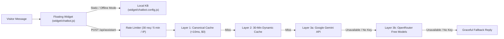

# Open Web Chatbot

A **zero-dependency, privacy-first hybrid AI chatbot widget** you can drop onto any website in 3 lines of HTML.

Built with pure vanilla JavaScript, CSS custom properties, and an optional serverless API (`api/assistant.js`) that combines **instant `$0` canonical Q&A**, **30-minute response caching**, **per-IP rate limiting**, and automatic **Gemini → OpenRouter** LLM fallback.

---

## Why This Method Works Better

Most tutorial chatbots send every single visitor click straight to a paid LLM API—making them slow, fragile, expensive, and useless on static sites. **Open Web Chatbot** solves that with a 3-layer hybrid pipeline:



### Key Features
- **Zero `npm` dependencies**: No React, no bundler, no `node_modules` bloat.
- **Works in 2 Modes**:
  - **Static Mode (`$0`, no backend)**: Runs directly on GitHub Pages, Cloudflare Pages, Netlify, or even local `file://`.
  - **Hybrid AI Mode (Free tiers)**: Add a `GEMINI_API_KEY` and/or `OPENROUTER_API_KEY` on Vercel for open-ended AI answers.
- **Single-File Customization**: Change your brand name, starter prompts, CTA links, and local FAQ inside `widget/chatbot.config.js`.
- **Themeable via CSS Variables**: Dark Neon default + built-in `light` and `ocean` themes.
- **Keyboard & Accessibility First**: `Ctrl+K` / `Cmd+K` shortcut, `Esc` to close, ARIA dialog semantics, mobile bottom-sheet layout, `prefers-reduced-motion` support.
- **Built-in PII & Secret Scanner**: Run `npm run check:pii` before pushing to Git so you never leak personal emails, phone numbers, or API keys.

---

## Repository Layout

```text
open-web-chatbot/
├── index.html                   # Interactive live demo & theme preview
├── widget/
│   ├── chatbot.config.js        # Edit this: brand copy, links, prompts & local KB
│   ├── chatbot.js               # Zero-dependency floating chat UI
│   └── chatbot.css              # CSS variable themes & responsive styles
├── api/
│   ├── assistant.js             # Serverless API (rate limit, cache, Gemini, OpenRouter)
│   └── knowledge.js             # Edit this: AI system prompt & server canonical cache
├── docs/
│   ├── HOW_TO_BUILD_WITH_GIT.md # Complete beginner-to-shipped Git & GitHub tutorial
│   ├── ARCHITECTURE.md          # Deep dive into caching, security & hybrid fallback
│   └── CUSTOMIZATION.md         # Embedding in HTML, React, Next.js, WordPress & theming
├── scripts/
│   ├── check-pii.mjs            # Pre-commit PII & API key scanner
│   └── test-api.mjs             # Unit tests for api/assistant.js
├── .env.example                 # Safe environment variable template
├── vercel.json                  # Ready-to-deploy Vercel config
└── .github/workflows/
    └── deploy-pages.yml         # Auto-deploy static demo to GitHub Pages
```

---

## 60-Second Quickstart

### 1. Preview locally right now
Clone the repo and open `index.html` in your browser—no build step needed:

```bash
git clone https://github.com/Aayush-Rajaji/open-web-chatbot.git
cd open-web-chatbot
```

Double-click `index.html` (or run `npx serve .` / `python -m http.server 8000`) and press **`Ctrl+K`** (or click the floating button).

### 2. Embed on any existing website
Copy the `widget/` folder into your website and add 3 lines before `</body>`:

```html
<link rel="stylesheet" href="widget/chatbot.css" />
<script src="widget/chatbot.config.js"></script>
<script src="widget/chatbot.js" defer></script>
```

### 3. Customize your chatbot
1. Edit [`widget/chatbot.config.js`](widget/chatbot.config.js) with your brand name, starter questions, links, and local FAQ answers.
2. Edit [`api/knowledge.js`](api/knowledge.js) with your verified facts for the LLM system prompt.
3. Run the verification checks:
   ```bash
   npm test
   npm run check:pii
   ```

---

## Step-by-Step Guides

- **New to building & shipping with Git?** Read the full walkthrough: **[How to Build & Ship Your Chatbot with Git](docs/HOW_TO_BUILD_WITH_GIT.md)**
- **Want to understand the engineering design?** Read **[Architecture & Security](docs/ARCHITECTURE.md)**
- **Embedding in React, Next.js, WordPress, or changing themes?** Read **[Customization Recipes](docs/CUSTOMIZATION.md)**

---

## Deployment Options

| Mode | Best For | Cost | How to Deploy |
| :--- | :--- | :--- | :--- |
| **Static Mode** | Portfolios, docs, landing pages on GitHub Pages | `$0` forever | Set `apiEndpoint: ''` in `widget/chatbot.config.js`, push to `main`, enable **Settings → Pages → GitHub Actions**. |
| **Hybrid AI Mode** | Full conversational AI + instant FAQ cache | Free tiers | Import your GitHub repo into **Vercel**, add `GEMINI_API_KEY` or `OPENROUTER_API_KEY` in Environment Variables, and deploy. |
| **Split Mode** | GitHub Pages frontend + Vercel AI backend | Free tiers | Deploy `/api/assistant` to Vercel with `ALLOWED_ORIGIN=https://your-site.github.io`, then set `apiEndpoint` in `widget/chatbot.config.js` to your Vercel URL. |

---

## Security & Open-Source Hygiene Checklist

Before running `git push`:
- [ ] Keep real API keys ONLY in `.env.local` (locally) or your hosting provider's Environment Variables dashboard.
- [ ] Verify `.env.local` is ignored by `.gitignore` (`git status` should never list `.env` or `.env.local`).
- [ ] Run `npm run check:pii` to confirm no personal phone numbers, private emails, or API tokens are accidentally hardcoded.

---

## License

MIT License — fork it, strip it, customize it, and ship it on as many websites as you like. See [LICENSE](LICENSE).
